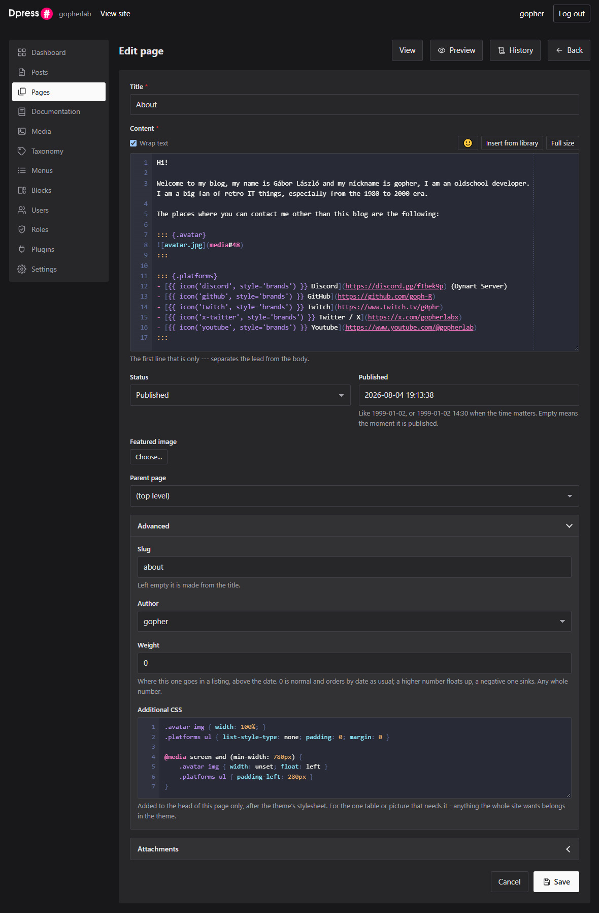
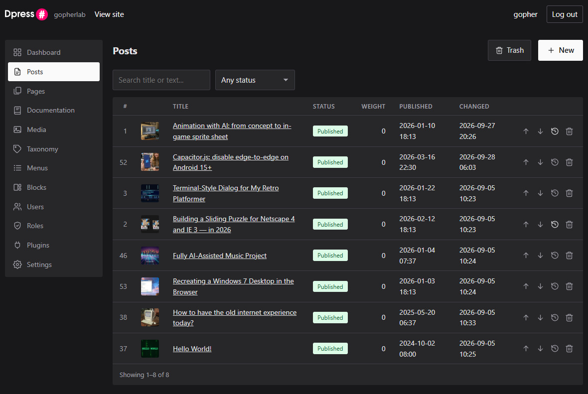

# Dpress

A CMS for a site you write in **markdown**. PHP 8.0+, MariaDB, MIT; built on
[dynart-micro](https://github.com/goph-R/dynart-micro) and
[dynart-micro-entities](https://github.com/goph-R/dynart-micro-entities).

It is for a site somebody writes rather than assembles: what you type is what is stored, pages are
rendered once when you save them, and the site itself loads **no JavaScript** unless a page has
something on it that needs it.

Status: **0.97.2**, feature complete and pre-1.0. Until 1.0 the database layout may still change,
and a change means recreating the database.





## What it does

- **Writing in markdown**, in an editor with colours, line numbers and a full-size mode — and never
  a WYSIWYG editor that rewrites your text. A media library, an emoji picker, and a preview that
  saves nothing.
- **Links that survive renaming** — a link names what it points at (`post#42`, `media#12`), not
  where it is, so renaming a page moves every link to it.
- **Long posts in pages, callouts, shortcodes, tables and syntax highlighting**, and a full
  revision history on every save.
- **Posts and pages**, categories and tags, featured posts on the front page, a feed and a sitemap.
- **Themes** — a theme is a folder; dropping it in installs it. **Blocks and menus** go into the
  places a theme offers, such as a sidebar.
- **Users, roles and permissions**, with rate-limited sign-in.
- **Plugins** — comments ([disqus](https://github.com/goph-R/dynart-dpress-disqus)), a Ko-fi
  button ([kofi](https://github.com/goph-R/dynart-dpress-kofi)) and icons
  ([fontawesome](https://github.com/goph-R/dynart-dpress-fontawesome)) exist already.
- **Fast** — about 43 ms of server time against WordPress's 568 ms for the same content on the same
  machine, with no caching on either side ([how it was measured](docs/performance.md)).
- **A command line** for installing, moving and looking after a site.

Each of these is described in [docs/features.md](docs/features.md).

## Installing a site

You need PHP 8.0+, MariaDB or MySQL, and Composer.

```bash
composer install

vendor/bin/dpress init \
    -base-url https://example.com \
    -db-name mysite -db-user mysite -db-password 'from your database' \
    -site-name "My Site"

# create the database itself, which Dpress does not do:
#   create database `mysite` character set utf8mb4 collate utf8mb4_unicode_ci;

vendor/bin/dpress install
vendor/bin/dpress user:create -email you@example.com -name "You" -role admin
vendor/bin/dpress doctor
```

Three things to know:

- Point the web server at the **`public/`** folder, never at the project root — `dpress.ini` holds
  the database password.
- `user:create` prints a generated password once.
- `doctor` checks that the installation is sound; run it last. Add `-dev` to `init` for a
  development site.

The explanation of each step is in [docs/installing.md](docs/installing.md). Moving a site to
another server is two commands, `dpress export` and `dpress import`; see
[docs/moving-a-site.md](docs/moving-a-site.md).

## Documentation

For running a site:

| | |
|---|---|
| [features.md](docs/features.md) | What Dpress does, in detail |
| [installing.md](docs/installing.md) | Requirements and every install step explained |
| [moving-a-site.md](docs/moving-a-site.md) | Export, import, and what to check afterwards |
| [cli.md](docs/cli.md) | Every `dpress` command |
| [roadmap.md](docs/roadmap.md) | What is left, and what each one has to decide first |
| [CHANGELOG.md](CHANGELOG.md) | What changed in each version, and what it was like before |

For writing, theming and extending:

| | |
|---|---|
| [themes.md](docs/themes.md) | Writing a theme: the folder, the layouts per kind of page, the assets |
| [blocks.md](docs/blocks.md) | Blocks, places, and adding a type |
| [plugins.md](docs/plugins.md) | What a plugin is, and every point it can hook |
| [internal-links.md](docs/internal-links.md) | `media#12` and friends, and why nothing stored holds a URL |
| [shortcodes.md](docs/shortcodes.md) | `{{ video('media#10') }}`, and writing one |
| [callouts.md](docs/callouts.md) | `> [!WARNING]` |
| [fenced-divs.md](docs/fenced-divs.md) | Boxes: `::: {.center}` ... `:::` |
| [code-highlighting.md](docs/code-highlighting.md) | Fenced code, and why the colours are not stored |
| [code-editor.md](docs/code-editor.md) | The admin editor's colours: three grammars of our own, EnlighterJS for the rest, and why |
| [autolinks.md](docs/autolinks.md) | Bare URLs in prose |
| [pages-in-content.md](docs/pages-in-content.md) | Long posts, served a page at a time |
| [media-in-the-editor.md](docs/media-in-the-editor.md) | Attachments against references, which are not the same thing |
| [comments.md](docs/comments.md) | Comments, through Disqus |
| [performance.md](docs/performance.md) | How to measure a Dpress site, and what the numbers were |
| [development.md](docs/development.md) | The source layout, the tests and the related repositories |

## License

MIT. See [LICENSE](LICENSE).
