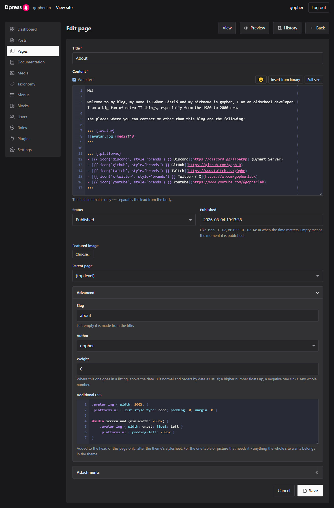

# What Dpress does

The long version. The [README](../README.md) has the short one.

**Writing.** Markdown, in a textarea with a code editor's comforts - colours, line numbers, a
wrap column, Tab indenting, full size - and never a WYSIWYG editor: a field whose value is
anything other than what the author typed eventually rewrites somebody's document on save. It is
dressed rather than replaced: the colours and the numbers are a backdrop behind the real field, so
the value, the selection and the undo stack are untouched. Two insert buttons, for the two things a
keyboard cannot do - inserting from the media library, which needs an id nobody memorises, and
picking an emoji - and **Preview media** (Alt+P), which shows the image, video or audio the cursor
is on, `media#12` or a relative path, over the dimmed page. The admin follows the machine's light
or dark scheme and can be **pinned to either** on the Admin UI tab, which is also what chooses
between the editor's two palettes - Dracula in the dark one, the same roles at 4.5:1 on white in
the light. The site's own pages are the theme's business and are not touched by it.

- The first line that is only `---` splits the **lead** from the body; every one after that is a
  **page break**, so a long post is served a page at a time with *Previous* and *Next*
  ([pages-in-content.md](pages-in-content.md)).
- **Internal links say what they point at, never where it is**: `media#12`, `post#42`, `page#5`,
  `category#21`, `tag#7` resolve at render time, so renaming a page moves every link to it
  ([internal-links.md](internal-links.md)).
- **Callouts** — `> [!WARNING]` is a coloured panel, and still a plain blockquote anywhere without
  Dpress ([callouts.md](callouts.md)).
- **Shortcodes** — `{{ video('media#10') }}`, parsed as CommonMark inline syntax, so one inside a
  code fence is left alone ([shortcodes.md](shortcodes.md)).
- **Syntax highlighting**, in the browser rather than in the stored HTML, so changing the theme
  re-colours every post and touches no document ([code-highlighting.md](code-highlighting.md)).
- Tables, bare URLs linked in prose but not in code, and a full **revision history** on every save.

**The site.** Posts and pages in one table; pages nest and live at their own paths, posts live at
`/post/<slug>` or `/<slug>` depending on a setting, with the other shape 301ing to it. Categories
are a tree, tags are flat, and a `featured` tag pins a strip to the front page. There is a
`/feed`, a `/sitemap.xml`, dates in the site's own timezone, and a media library with lazy
thumbnails and SVGs sanitised on the way in.

**Themes and blocks.** A theme is [a folder with a `theme.ini` in it](themes.md) — dropping
it in installs it, and which one renders is a setting. A theme may have a layout per kind of page
(`home`, `archive`, `post`, `page`, `auth`) and having the file is the whole registration - and,
as in WordPress, a template for one category, tag, page or post (`category-retro.phtml`,
`page-about.phtml`, by slug or by id), so a category can be a gallery. A
[block](blocks.md) is something in a place beside the content — a tag cloud, a category list,
a piece of markdown — and a **menu** is assigned to the same places, its items storing a target
rather than a URL so a rename moves them.

**Who may do what.** Users, roles and plain-string permissions, JWT in cookies with rotating
refresh tokens, rate limiting on every way in, and a site that refuses to let you remove its last
administrator. The **admin** role holds every permission, including ones a plugin adds later, so
it has nothing to tick in the role editor and cannot be removed. Deleting a user never deletes
what they wrote.

**Extending it.** [Plugins](plugins.md) are a folder under `plugins/` with a `plugin.ini`,
enabled through a setting. Every form and every query is built by a factory that emits an event,
so a plugin can add a field or narrow a listing without a fork; permissions, block types,
shortcodes, field widgets, entities and migrations are all registrations. Three exist —
[disqus](https://github.com/goph-R/dynart-dpress-disqus),
[kofi](https://github.com/goph-R/dynart-dpress-kofi) and
[fontawesome](https://github.com/goph-R/dynart-dpress-fontawesome) — and the Ko-fi one used to be
in core, which is the test of whether the extension points are real.

**How fast.** On a contended shared VPS, the same content on the same machine: **~43 ms of server
time against WordPress's ~568 ms**, about 13×, with no caching plugin on either side. About 95% of
that 43 ms is boot; the page's own work is a couple of milliseconds.
[performance.md](performance.md) is how to measure it yourself rather than take that on trust.
